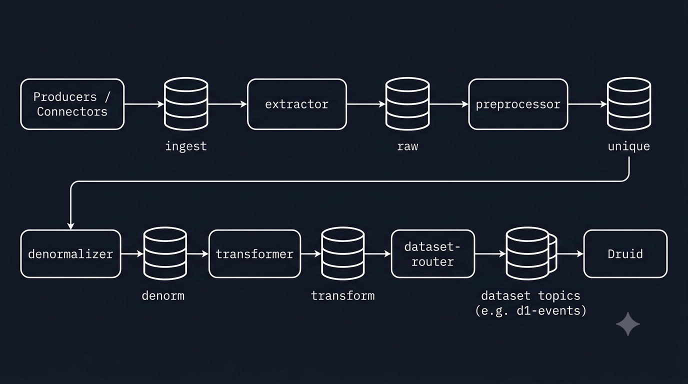
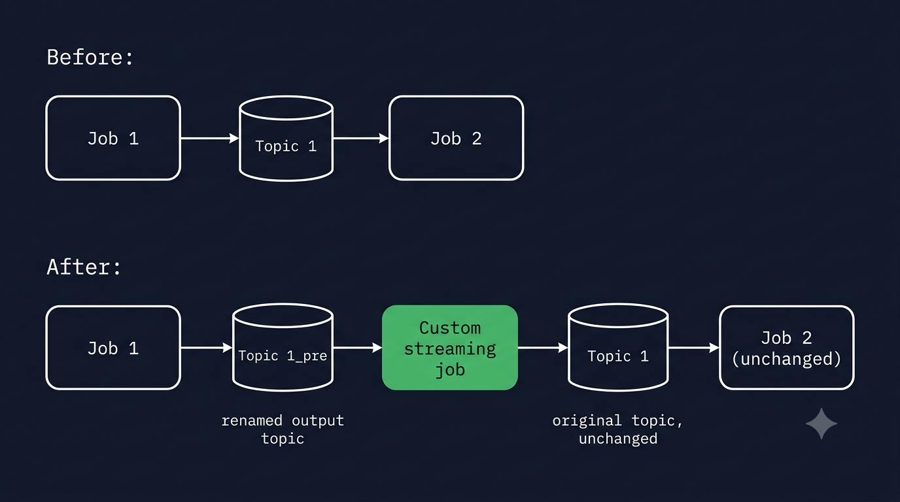
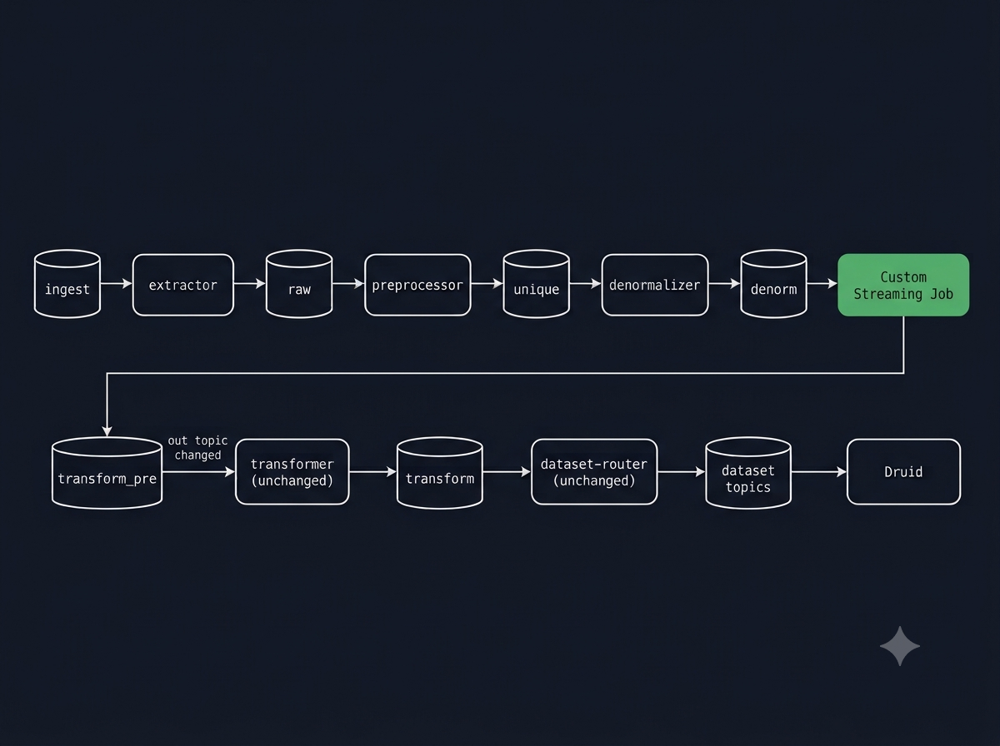

# Extending Obsrv with Custom Processing Logic

## Why?

Obsrv datasets already support JSONata expressions for transformation — for straightforward field mapping and reshaping, that's the standard path, no infra change needed. But JSONata has limits: it can't call external systems, run extensive/multi-step custom logic, or do anything beyond expression evaluation.

When your transformation genuinely needs more than JSONata can express — before the data lands in storage, whether that's analytics (Druid) or a transactional/lakehouse store — you need your own code running as a step in the pipeline. That's what a custom job is: your own Kafka consumer/producer (Python, Node.js, or any language) inserted into the event flow. It's **not tied to any particular purpose** — it can enrich events, filter them, call external systems, reshape fields, or something else entirely.

## How?

There are three solutions:

1. **Solution 1: Drop the custom stream job in between the unified pipeline** — switch the unified pipeline to individual jobs, then insert custom logic between any two stages. Covered in "Solution 1" below.
2. **Solution 2: After the pipeline router** — keep the unified pipeline as-is, and insert custom logic after the router by fanning out a second consumer on its output topic. Covered in "Solution 2".
3. **Solution 3: Write a custom connector** — run your transformation logic inside the source connector itself, before the event ever reaches the pipeline. Covered in "Solution 3".

| Your situation | Use |
| --- | --- |
| Custom code between two specific stages (needs pipeline-enriched input, e.g. denormalized fields) | Solution 1: individual jobs + processor in the gap |
| Custom code on final routed events, and comfortable owning a manual Druid cutover | Solution 2: After the pipeline router |
| Logic can run entirely at the source, before any event reaches Obsrv | Solution 3: Write a custom connector |

## How the pipeline is structured today

Every pipeline stage is an independent Flink job with a Kafka **in** topic and a Kafka **out** topic:

| Job | In topic | Out topic | Failed topic |
| --- | --- | --- | --- |
| extractor | `ingest` | `raw` | `failed` |
| preprocessor | `raw` | `unique` | `failed` |
| denormalizer | `unique` | `denorm` | `failed` |
| transformer | `denorm` | `transform` | `transform.failed` |
| dataset-router | `transform` | per-dataset `router_config.topic` (the topic this dataset's events land in — e.g. `d1-events`) | `failed` |

**Existing Unified Pipeline flow:**

<figure><figcaption></figcaption></figure>

## If your job changes the event shape

If your custom job adds a new field, or changes the data type of a field that already exists, update the dataset's schema in the console **before** that job's output reaches Druid. Skip this and a new field is silently dropped, or a type-changed field fails ingestion outright — since Druid ingests strictly against the schema it already knows.

1. Open the dataset in the Obsrv management console.
2. Go to **Schema Details** → **Ingestion**.
3. New field your job adds (e.g. `meta`): click **Add Field**, enter the exact field name your job writes, and pick its type.
4. Existing field whose type your job changes: find it in the list and update its **Type** to match what your job now emits.
5. Save and publish — this regenerates Druid's ingestion spec with the updated field list before any reshaped event arrives.

You (or whoever writes the custom job) already know what it does to the event, so make this schema change first, then deploy the job.

## Solution 1: Drop the custom stream job in between the unified pipeline

This requires switching from the unified pipeline to individual jobs first — five separate Flink jobs instead of one. Instead of deploying the unified pipeline from the automation charts, disable it and deploy each job individually — refer to [obsrv-core](https://github.com/Sanketika-Obsrv/obsrv-core) for each job's build and deployment steps.

Because every stage reads from a topic and writes to a topic, inserting custom code between **any** two stages is always the same three moves:

1. **Rename the downstream stage's in topic** to a new "pre" topic (one line in that job's configuration).
2. **Run your custom job** consuming the upstream stage's **unchanged, stock out topic**, and producing to the new "pre" topic.
3. **Leave every other job untouched — including the upstream stage.**

<figure><figcaption></figcaption></figure>

For example, inserting between **denormalizer and transformer**:

1. Override the downstream job's in topic in its configuration:

```hocon
# transformer job config
kafka {
  input.topic = "transform_pre"   # stock value: "denorm"
  output.transform.topic = "transform"
}
```

2. Create the `transform_pre` topic (partition count = the stock topic's partition count).
3. Run the custom job with `IN_TOPIC=denorm`, `OUT_TOPIC=transform_pre`.
4. Denormalizer (`unique` → `denorm`) and router (`transform` → dataset topics) stay on stock configuration.
5. If this job adds or retypes fields, do the schema update in "If your job changes the event shape" above first.

Resulting flow:

<figure><figcaption></figcaption></figure>

The upstream stage never knows the difference — it keeps producing to its stock out topic; events simply pass through your code first. For any other gap, substitute the topic pair. E.g. between preprocessor and denormalizer: denormalizer `input.topic = "unique_pre"`, processor `unique` → `unique_pre`. The in-topic key per job: extractor `kafka.input.topic`, preprocessor `input.topic`, denormalizer `input.topic`, transformer `input.topic`, dataset-router `input.topic`.

### Pick the insertion point and rewire one topic

Pick the gap based on **what your code needs as input** — and what shape the events are in at that point:

| Insertion point | Events carry | Typical use |
| --- | --- | --- |
| before extractor (`ingest`) | batch envelope: `{"dataset": "...", "events": [...]}` (or `{"event": {...}}` for a single event) | normalize source payloads |
| preprocessor → denormalizer | single-event envelope: `{"event": {...}, "obsrv_meta": {...}}` | enrich before denorm lookups |
| denormalizer → transformer | single-event envelope, with denormalized fields present | logic that needs master-data joins |
| transformer → router | single-event envelope, with JSONata outputs present | post-process transformed fields |

When unwrapping a single-event envelope, modify the nested `event` object and pass `obsrv_meta` through unchanged — it carries stage flags and timings the rest of the pipeline relies on.

## Solution 2: After the pipeline router

1. If your job adds or retypes fields, do the schema update in "If your job changes the event shape" above first, and publish.
2. Deploy your custom job: consume the dataset's live topic (e.g. `user-data`) as a second consumer group, produce to a new topic with a different name (e.g. `user-data-processed`). See "Reference: the custom streaming job" below for a minimal example.
3. Confirm the job is healthy and producing correctly-shaped events to the new topic.
4. Take the existing supervisor's spec, change `dataSchema.dataSource` to a new name and point `ioConfig.topic` at the new topic, and submit it via the Druid console or Supervisor API — this creates a new, separate Druid datasource ingesting the processed data.
5. Once the new datasource's supervisor is healthy and ingesting correctly, suspend the original, obsrv-created datasource's supervisor.

Queries/dashboards on this dataset now need to point at the new datasource name.

## Solution 3: Write a custom connector

1. Base your connector on an existing open-source Obsrv connector — e.g. [jdbc-connector](https://github.com/Sanketika-Obsrv/jdbc-connector) — and adapt it for your source/use case.
2. Run your transformation logic inside the connector itself, before it produces the event — see the [connectors developer guide](../connectors-developer-guide/README.md) for interfaces and packaging.
3. Your connector produces wherever the reference connector already produces to — no topic rewiring or Druid cutover needed.
4. If your connector adds or retypes fields, still do the schema update in "If your job changes the event shape" above first.
5. Package and deploy per the connector guide's packaging steps.

## Reference: the custom streaming job

For reference, not a required step — any Kafka client works for the custom streaming job used above, it just needs to consume `IN_TOPIC`, run your logic, and produce to `OUT_TOPIC`. Matching Solution 2, where events are flat, in Python:

```python
for msg in consumer:                       # consume IN_TOPIC
    event = json.loads(msg.value())        # after-router output is flat — no wrapper
    event["metadata"] = my_custom_logic(event)   # <- your code
    producer.produce(OUT_TOPIC, json.dumps(event).encode())
```

That's it — the pipeline stages on either side don't need to know it's there. If you're inserting **between individual jobs** instead (Solution 1), events are wrapped in an envelope, not flat — see "Pick the insertion point and rewire one topic" above for the exact shape to unwrap.


Obsrv Flink producers use **snappy** compression, so `confluent-kafka` (Python) works out of the box; Node.js `kafkajs` needs the `kafkajs-snappy` codec registered.

